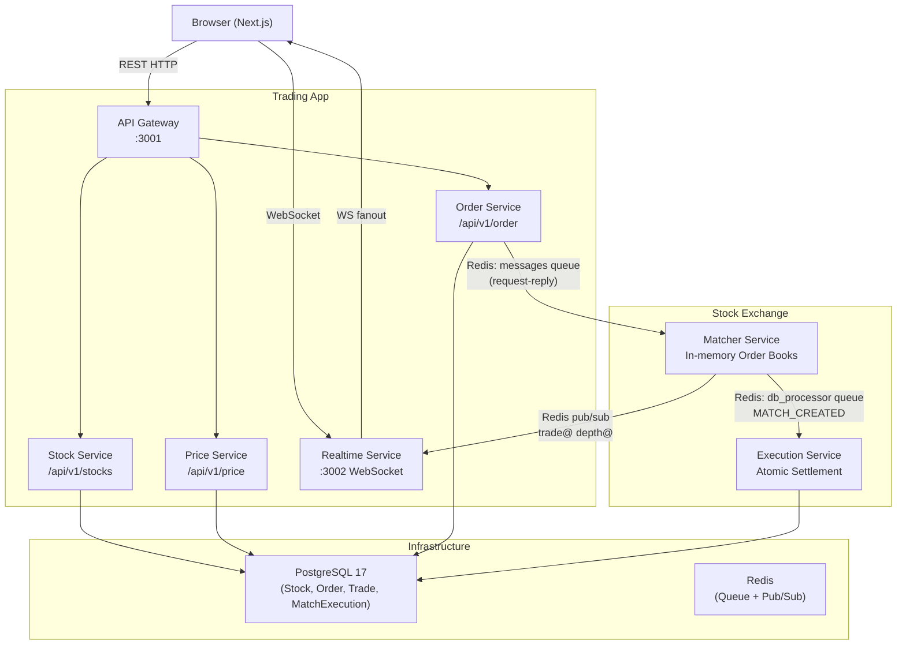

# StockX — Architecture

## System Overview

StockX separates two concerns that the CortexCookie designs keep distinct:

1. **Stock Trading App** — the user-facing application (API Gateway, Stock Service, Price Service, Order Service, Realtime Service, Frontend)
2. **Stock Exchange** — the matching and execution engine (Matcher Service, Execution Service)

Both run in the same repository and Docker Compose environment, but their responsibilities are deliberately separated.

---

## Architecture Diagram



---

## Service Responsibilities

### API Gateway (`packages/api-gateway`)
- Single HTTP entry point for all client requests
- Routes to Stock Service, Price Service, Order Service
- Forwards orders to Matcher Service via Redis request-reply
- Generates UUID order IDs and persists Order rows before sending to matcher
- No matching logic

### Stock Service (routes within API Gateway)
- `GET /api/v1/stocks` — list active tradeable stocks
- `GET /api/v1/stocks/:symbol` — single stock metadata
- Backed by the `Stock` table in PostgreSQL

### Price Service (routes within API Gateway)
- `GET /api/v1/price/tickers` — 24h OHLCV summary computed from the `Trade` table
- `GET /api/v1/price/history/:symbol` — recent trades for sparklines and chart data
- No TimescaleDB — all price data derived from plain SQL queries

### Order Service (routes within API Gateway)
- `POST /api/v1/order` — validate, persist as OPEN, forward to Matcher
- `DELETE /api/v1/order` — cancel open order
- `GET /api/v1/order/open` — live open orders (from Matcher in-memory)
- `GET /api/v1/order/history` — persisted order history from PostgreSQL

### Matcher Service (`packages/matcher-service`)
- Loads all user wallets from PostgreSQL at startup
- Maintains one in-memory `Orderbook` per symbol (`RIL_INR`, `TATA_INR`, `SOL_INR`)
- Applies price-time priority matching on every `CREATE_ORDER`
- Validates and locks user funds before accepting an order
- Emits `MATCH_CREATED` events → Redis `db_processor` queue
- Emits `ORDER_UPDATE` events → Redis `db_processor` queue
- Publishes `trade@SYMBOL` and `depth@SYMBOL` to Redis pub/sub

### Execution Service (`packages/execution-service`)
- Consumes `MATCH_CREATED` and `ORDER_UPDATE` from Redis `db_processor`
- For each match: atomic PostgreSQL transaction that:
  1. Inserts `MatchExecution` row (unique on `matchId` — idempotency key)
  2. Locks both wallet rows with `FOR UPDATE`
  3. Debits buyer, credits seller
  4. Inserts public `Trade` record
  5. Inserts `Transaction` audit records
  6. `COMMIT` — or `ROLLBACK` on any failure
- Duplicate `matchId` → unique constraint violation → skip silently

### Realtime Service (`packages/realtime-service`)
- WebSocket server on port 3002
- Clients subscribe to `trade@SYMBOL` and `depth@SYMBOL` streams
- Subscribes to those Redis channels lazily (only while a client is interested)
- Fans out Redis messages to all subscribed browser connections

### Frontend (`packages/web`)
- Next.js 16 app
- Pages: `/` (home), `/markets`, `/trade/[symbol]`, `/user`, `/user/portfolio`, `/user/orders`
- `MarketDataManager` singleton manages the browser WebSocket connection
- Order entry, real-time order book, live trade feed, price chart built from trades

---

## Data Flow Summary

### Order placement (happy path, limit order, no immediate match)

```
Browser → POST /api/v1/order
        → API Gateway validates + persists Order(status=OPEN)
        → lPush "messages" { clientId, CREATE_ORDER }
        → Matcher brPop → lockFunds → addOrder(rest=true) → no fills
        → publish(clientId, ORDER_PLACED{restingOnBook:true})
        → API Gateway resolves → 201 response to browser
```

### Trade execution (two matching limit orders)

```
SELL order arrives → Matcher matches against existing BUY
        → Fill created: matchId = randomUUID()
        → In-memory wallets updated
        → lPush "db_processor" MATCH_CREATED{matchId, ...}
        → lPush "db_processor" ORDER_UPDATE{...}
        → publish "trade@SYMBOL" → Realtime → Browser WS
        → publish "depth@SYMBOL" → Realtime → Browser WS
        → Execution Worker brPop MATCH_CREATED
        → BEGIN TX
        → INSERT MatchExecution (matchId unique — idempotency)
        → SELECT Wallet FOR UPDATE (both)
        → UPDATE Wallet (debit/credit)
        → INSERT Trade
        → INSERT Transaction x2
        → COMMIT
```

---

## In-Memory Order Book

Each `Orderbook` maintains two arrays:

- `bids: Order[]` — sorted by price DESC, then insertion sequence ASC (best buy price first)
- `asks: Order[]` — sorted by price ASC, then insertion sequence ASC (best sell price first)

Orders are inserted in sorted position at insertion time, so matching runs in O(n) without re-sorting.

**Price-time priority:**
- A BUY order matches the cheapest available ask first
- A SELL order matches the highest available bid first
- At the same price, the earliest order (lowest seq) executes first

---

## Database Schema (PostgreSQL)

```
User          — authentication (cuid PK)
Account       — OAuth accounts (NextAuth)
Wallet        — balance + assetsHeld JSON per user
Stock         — tradeable instruments (RIL, TATA, SOL)
Order         — durable order store (UUID PK, status lifecycle)
MatchExecution — idempotency table, one row per settled match
Trade         — public trade feed
Transaction   — wallet audit log
```

---

## What Is NOT Implemented (Future Scope)

- Kafka / message broker (Redis queues are sufficient for this scale)
- Matcher sharding across multiple processes
- Order expiry at end of trading day
- Stop-loss / iceberg order types
- Multi-region deployment
- Email notifications
- Market making / trading bots
